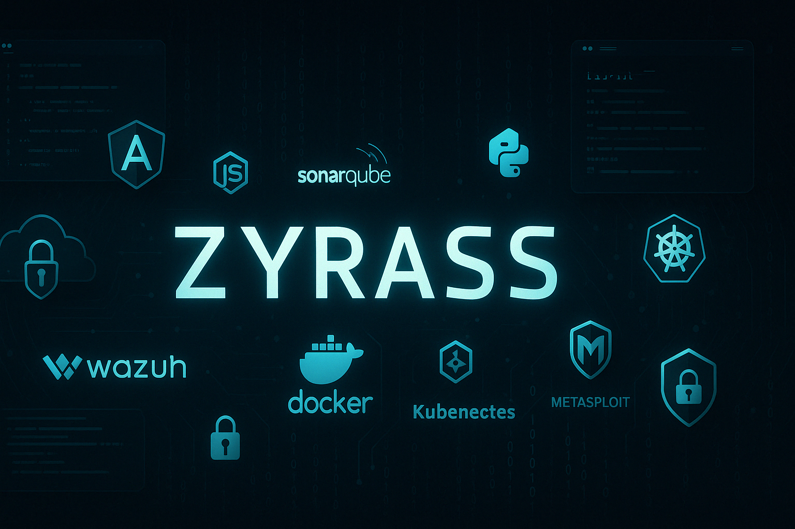

    

    

<h1 align="center" style="margin:50px 0;">À propos de moi</h1>

**Développeur Full Stack certifié** ( _Bac+4_ ) 
Obtenu avec les félicitations du jury, en reconversion vers une nouvelle certification : _**Expert en Sécurité Digitale**_ .

Passionné par les **technologies du web**, la **Cybersécurité** et le **DevSecOps**, je poursuis activement ma formation dans le domaine de la sécurité informatique 

✅ **Objectif actuel** : Finaliser la présentation et la soutenance de ma formation d'ici le 29 avril 2025.

À 40 ans, je reste animé par une soif d'apprendre inépuisable et une motivation constante pour rester à la pointe des dernières avancées technologiques.

 
 

## Système d'exploitation

-   **Windows** : Windows 98, ME, 2000, XP, 7, 10, 11
-   **macOS** : 1 an d'expérience
-   **Linux** : Ubuntu, Debian, Kali, Parrot OS, Rocky Linux 9 (serveur)

 

## Compétences techniques

 

**Frontend**

-   **Langages** : HTML5, CSS3, JavaScript, TypeScript
-   **Frameworks** : Angular, React (Librairie)
-   **UI & CSS** : TailwindCSS, Bulma, Bootstrap, Sass
-   **Outils de test & doc** : Docusaurus, Compodoc, Swagger, Mermaid, Jest, Jasmine, Karma, Cypress, PhpUnit

 

**Backend**

-   **Runtime JavaScript** : Nodejs
-   **Langages** : PHP (Larave), Python, Java (Spring Boot)
-   **Frameworks & Outils** : Express, EJS, PUG, Twig
-   **Base de données** : MongoDB, MySQL (maria db), SQLite,PostgreSQL
-   **ORM (Object Relational Modeling) / ODM (Object Data Modeling)** : Eloquent, Mongoose
-   **Authentification & API** : JWT, Postman

 

**DevSecOps - (Sécurité + Déploiement + Observabilité)**

-   **CI/CD (Intégration continue)** : Github Actions & Jenkins
-   **Containers & Orchestration** : Docker, Kubernetes (k8s), Helm, Vault
-   **Infrastructure as Code & automation** : Ansible, OpenTodu, Packer
-   **Monitoring** : graphana, prometheus
-   **Sécurité & Qualité du code** : SonarQube, Trivy (scan d'images Docker), Checkov (audit IaC), Bandit (analyse de code Python), ESLint/TSLint (JS/TS)
-   **Serveurs & virtualisation**: Vagrant, Nginx, Apache, Virtualbox, PM2
-   **Contrôle de version** : git (GitHub,GitLab,Bitbucket)

 

**Cloud & Services**

-   **Cloud Provider** : AWS
-   **Services AWS**: IAM (gestion des accès), S3, EC2, VPC, CloudWatch, Lambda

 

**Mobile**

-   **Frameworks** : Kotlin multiplateform, react native

 

---

 

## CyberSécurité - (Red Team + Blue Team + Forensic)

 

**Pentest & Audit**

-   Wapiti, Nikto, Nmap, Gobuster, OWASP ZAP, Burp Suite
-   TheHarvester, Metasploit, Medusa, JohnTheRipper, Hydra, SQLmap

 

**Blue TEAM / Forensic / Analyse**

-   ClamAV, rkhunter, Suricata, Snort
-   Volatility, Foremost, Scalpel, Wireshark, Yara, CyberChef
-   dc3dd, dd, SCP, Lynis, Wazuh

 

**Gouvernance & Conformité**

-   Ebios-RM, PIA, ISO 27001/27002, NIS 2, connaissance en SMSI

 
 

## Outils & Productivité

 

-   **IDE** : Visual Studio Code & Visual Studio Code Community
-   **Templating** : EJS, PUG, TWIG
-   **Design & Maquettage** : Figma, FigJam, Canva
-   **Shell** : bash, zsh
-   **collaboration** : Trello, Markdown
-   **SGBD** : MySQL Workbench, MongoDB Compass, phpmyadmin
-   **Standards** : W3C, WCAG
-   **Package managers** : npm, yarn, pnpm, composer
-   **Déploiement** : Microsoft Azure, 1and1, heroku, netlify, OVH

 

---

<h3 align="center" style="margin:50px 0;">Ce que je vous propose, c'est de construire l'avenir ensemble</h3>

---

 

<h2 align="center" style="margin: 50px 0; text-transform: uppercase;">Quelques projets</h2>

&nbsp;&nbsp;&nbsp;&nbsp;&nbsp;&nbsp;

<h3 align="center" style="margin: 50px 0; text-transform: uppercase;">Mes statistiques sur github</h3>

 

<h3 align="center" style="margin: 50px 0 25px; text-transform: uppercase">🌐 CONNECTEZ-VOUS À MES RÉSEAUX SOCIAUX EN UN CLIC !</h3>

    
    
    
    

---

<!--
DART  = 00B4AB
C++   = f34b7d
CS    = 178600
JS    = f1e05a
SHELL = 89e051

 ## 3. Badge des contributeurs
 

-------------------------------

  

      

 

-->
